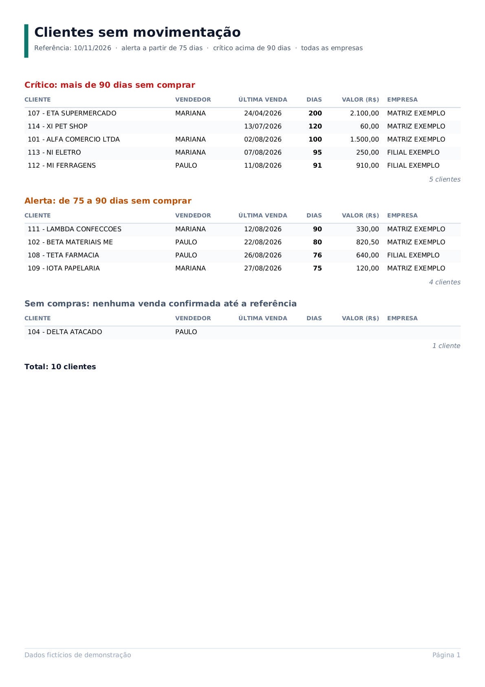

# Sankhya ERP: portfólio de personalizações

Exemplos do tipo de trabalho que fiz como desenvolvedor freelancer de personalizações para o ERP **Sankhya**: extensões em **Java**, consultas **SQL** e relatórios **JasperReports**.

Tudo aqui foi **reescrito do zero a partir dos requisitos**, com dados inventados. Não há código, layout, regra comercial nem dado de nenhum cliente.



## O que tem aqui

| Pasta | Exemplo | O que mostra |
|---|---|---|
| [`java/`](java/) | **Exportar XML de NF-e:** botão de ação que gera um ZIP com o XML de distribuição (nfeProc) das notas selecionadas | Montagem do nfeProc preservando a assinatura digital (validada criptograficamente nos testes), chave de acesso (módulo 11), conferência do protocolo da SEFAZ, proteção contra XXE, 40 testes JUnit |
| [`sql/`](sql/) | **Clientes sem movimentação:** clientes ativos sem comprar há X dias, por faixa (crítico, alerta, sem compras) | CTE, `ROW_NUMBER()`, `LEFT JOIN`, parâmetros, SQL escrito com recursos comuns ao Oracle e ao PostgreSQL, testes automáticos com resultado esperado |
| [`jasper/`](jasper/) | **Relatório de clientes sem movimentação** em PDF | Grupos com cabeçalho e rodapé, estilos condicionais, contagem por grupo, parâmetros e o PDF gerado a partir de um banco de exemplo |

## Como rodar

Precisa de um JDK 11 ou mais novo e, para SQL e Jasper, do Docker.

```bash
./gradlew test               # testes da regra de negócio em Java (sem precisar do Sankhya)
sql/testes/rodar.sh          # testa as consultas num PostgreSQL descartável
jasper/gerar-exemplo.sh      # gera o PDF e o PNG de jasper/exemplos
```

No Windows, os scripts `.sh` rodam pelo Git Bash ou pelo WSL.

## O que foi validado

- **Java:** a regra de negócio tem 40 testes JUnit. O adaptador que roda dentro do ERP compila contra as bibliotecas do Sankhya 4.35, que são proprietárias e **não estão neste repositório**. Esta versão reescrita não foi executada dentro de um ERP.
- **SQL:** a consulta roda num PostgreSQL 16 com dados de exemplo e é comparada com um resultado escrito à mão, que cobre os limites (exatamente 75 e 90 dias, devoluções, pedidos pendentes, vendas futuras, empate no mesmo dia, venda antiga e recente, filtro por empresa). No Oracle ela não foi executada.
- **Jasper:** o relatório é compilado e preenchido pelo JasperReports 6.21, e o PDF de [`jasper/exemplos`](jasper/exemplos/) sai desse processo.

## Sobre

Trabalhei como freelancer para uma consultoria de implantação do Sankhya, desenvolvendo extensões Java (botões de ação, eventos programáveis), consultas, dashboards e relatórios para empresas de diferentes ramos. Este repositório reúne versões novas de soluções desse tipo, para mostrar como eu resolvo esses problemas hoje, com testes e documentação.

Desenvolvido com apoio de IA (Claude Code, com revisão do Codex). As decisões técnicas e a validação são minhas.

**Diogo Queiroz** · [github.com/Dqueir0Z](https://github.com/Dqueir0Z)
