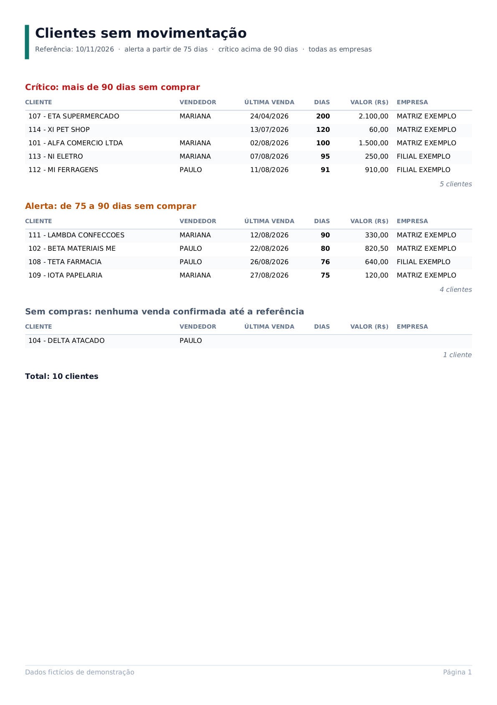

# JasperReports: relatórios para o Sankhya

## Clientes sem movimentação

[`relatorios/clientes_sem_movimentacao.jrxml`](relatorios/clientes_sem_movimentacao.jrxml) · [PDF de exemplo](exemplos/clientes_sem_movimentacao.pdf)



Mesma regra da consulta de [`sql/`](../sql/), em formato de relatório para impressão:

- **Grupo por faixa** (crítico, alerta, sem compras), com título próprio e a contagem de clientes de cada faixa no rodapé do grupo.
- **Estilos condicionais:** a cor do título muda conforme a faixa, e as linhas são zebradas.
- **Parâmetros** com valor padrão (`DATA_REF` = hoje, `DIAS_ALERTA` = 75, `DIAS_CRITICO` = 90; `CODEMP` vazio = todas as empresas). O cabeçalho mostra os filtros usados.
- **`CAST` nos parâmetros da consulta:** o driver JDBC do PostgreSQL envia o parâmetro sem tipo, e o `CAST` deixa explícito que é data ou inteiro. É SQL padrão, aceito também pelo Oracle.

O `.jrxml` segue o formato do JasperReports 6, o mesmo do Jaspersoft Studio (sucessor do iReport).

## Gerar o PDF de exemplo

```bash
jasper/gerar-exemplo.sh
```

Sobe um PostgreSQL descartável no Docker com os dados de [`sql/testes/dados`](../sql/testes/dados/), compila o relatório, preenche e grava o PDF e o PNG em [`exemplos/`](exemplos/). O gerador ([`gerador/`](gerador/)) é um programa Java pequeno com a biblioteca do JasperReports.
